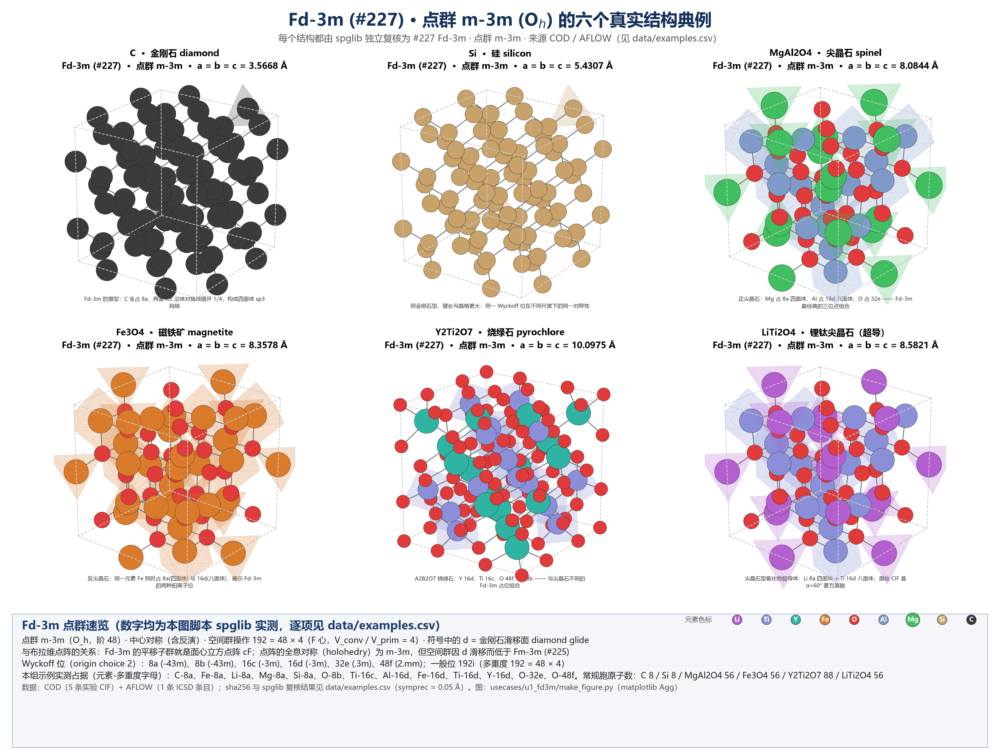

# 用例 1：Fd-3m (#227) 点群 m-3m 的六个真实结构典例

> 用户原话：“我需要向学生们讲解 Fd3m 点群的性质，帮我找一些典例，排成 png。”
>
> 本目录产出：`figures/fd3m_examples.png`（2×3 面板教学图 + 底部性质信息框）、
> `data/examples.csv`（6 条结构的来源/晶胞/对称性/sha256 实测记录）、
> `data/structures/*.cif`（原始 CIF 留档）、`data/provenance.json`（下载溯源）、
> `make_figure.py`（离线可重跑的出图脚本）+ `scripts/fetch_structures.py`（联网抓取脚本）。



---

## 1. 一句话结论

六个结构**全部**由 spglib 独立复核为 **#227 Fd-3m、点群 m-3m**（`examples.csv` 的
`sg_number` 全为 227、`point_group` 全为 m-3m、`verified_227` 全为 1）；
点群 m-3m 的阶为 48，空间群操作 192 个 = 48 × 4（F 心），且含反演（中心对称）。

---

## 2. Fd-3m 的性质（讲稿）

| 性质 | 内容 | 本图/本目录的证据 |
|---|---|---|
| 点群 | **m-3m**（Schoenflies $O_h$），阶 **48** | `examples.csv: point_group / pointgroup_order=48` |
| 空间群操作 | **192** 个 = 48（点群）× 4（F 心平移） | `examples.csv: n_symops=192`；spglib 直接计数 |
| 中心对称 | 含反演 $-I$ | `examples.csv: inversion=1`（spglib 旋转矩阵里找到 $-I$） |
| 布拉维点阵 | **cF（面心立方）**：$V_{conv}/V_{prim}=4$ | `examples.csv: centering_mult=4, bravais=cF` |
| 滑移面 | 符号中的 **d** = 金刚石滑移面（diamond glide，滑移 $(a+b+c)/4$） | 由空间群符号 `F d -3 m` 定义；本组结构均属该群 |
| Wyckoff 位（origin choice 2） | 8a (-43m)、8b (-43m)、16c (-3m)、16d (-3m)、32e (.3m)、48f (2.mm)；一般位 **192i**（多重度 192 = 48×4） | `examples.csv: wyckoff_choice2` 为 spglib Hall 526 实测字母；192i 的多重度由 48×4 算得 |
| 与 cF 的关系 | Fd-3m 的**平移子群就是 cF**；点阵的全息对称（holohedry）为 m-3m，但**空间群**因 d 滑移低于 Fm-3m (#225) | 见 `centering_mult=4` 与空间群号 227 |
| 常规胞原子数 | C 8、Si 8、MgAl₂O₄ 56、Fe₃O₄ 56、Y₂Ti₂O₇ 88、LiTi₂O₄ 56 | `examples.csv: natoms_conv` |

**读图方法**：每个面板画的是“常规立方胞 × reps”的球棍模型（蓝灰色虚线为显示盒边界），
半透明多面体是按显式截断找到的阳离子配位多面体；标题三行信息分别是
化学式 / 空间群 #227 与点群 m-3m / 常规胞 $a=b=c$；面板底部小字是该结构“为什么典型”。

---

## 3. 六个典例为什么典型

1. **C 金刚石**（COD 9008564，$a=3.5668$ Å）：Fd-3m 的原型。C 全部占 **8a**，
   两套 fcc 沿体对角线错开 $1/4$，每个 C 是四面体 sp³ 配位。看图中四面体网络即可理解
   Fd-3m 的 8a 位与 cF 点阵的关系。
2. **Si 硅**（COD 9008565，$a=5.4307$ Å）：与金刚石同型、只是尺度更大（$\times 1.52$），
   说明“同一 Wyckoff 位 + 同一对称性”不依赖具体化学元素。
3. **MgAl₂O₄ 正尖晶石**（COD 9001364，$a=8.0844$ Å）：**8a（Mg 四面体）+ 16d（Al 八面体）+ 32e（O）**
   是 Fd-3m 最经典的三位点组合，也是学生必须记住的对应关系。
4. **Fe₃O₄ 磁铁矿**（COD 9005813，$a=8.3578$ Å）：反尖晶石，**同一元素 Fe 同时占 8a 与 16d**，
   直观展示“元素相同但 Wyckoff 位不同 ⇒ 配位环境不同（四面体 vs 八面体）”。
5. **Y₂Ti₂O₇ 烧绿石**（COD 1559965，$a=10.0975$ Å）：A₂B₂O₇ 型，**Y 16d、Ti 16c、O 48f、O′ 8b**，
   与尖晶石完全不同的 Fd-3m 占位组合，说明 Fd-3m 并不只属于尖晶石。
6. **LiTi₂O₄ 锂钛尖晶石**（AFLOW/ICSD 81329，常规胞 $a=8.5821$ Å）：尖晶石型氧化物超导体，
   Li 8a + Ti 16d。它的原始 CIF 给的是 **α=60° 菱方原胞（$a_{prim}=6.0685$ Å）**，
   spglib 标准化得到 $a_{conv}=8.5821$ Å，正好满足 $a_{conv}=a_{prim}\sqrt2$
   （6.06849×1.41421 = 8.58213）——顺带演示了“cF 点阵的菱方原胞描述”这一关系，
   与用例 2 的 cF≡hR 结论互相印证。

---

## 4. 数据来源（全部真实数据库记录，非手搓结构）

| # | 化学式 | 来源 | 记录 id / URL | CIF sha256（前 16 位；全长见 CSV） | spglib 复核 |
|---|---|---|---|---|---|
| 1 | C | COD | `9008564` · https://www.crystallography.net/cod/9008564.cif | `ba61fbf894db…` | 227 Fd-3m, m-3m |
| 2 | Si | COD | `9008565` · https://www.crystallography.net/cod/9008565.cif | `46fb44ccdf93…` | 227 Fd-3m, m-3m |
| 3 | MgAl₂O₄ | COD | `9001364` · https://www.crystallography.net/cod/9001364.cif | `82fa52c62dd4…` | 227 Fd-3m, m-3m |
| 4 | Fe₃O₄ | COD | `9005813` · https://www.crystallography.net/cod/9005813.cif | `1330cd1223a5…` | 227 Fd-3m, m-3m |
| 5 | Y₂Ti₂O₇ | COD | `1559965` · https://www.crystallography.net/cod/1559965.cif | `fac71bf54a9b…` | 227 Fd-3m, m-3m |
| 6 | LiTi₂O₄ | AFLOW (ICSD 81329) | `aflowlib.duke.edu:AFLOWDATA/ICSD_WEB/FCC/Li1O4Ti2_ICSD_81329` | `7e93ba0fcbf7…` | 227 Fd-3m, m-3m |

检索方式（写入 CSV 的 `search` 列）：

* COD：REST JSON `https://www.crystallography.net/cod/result?text=<关键词>&format=json` 先按
  `sg` 字段含 `F d -3 m` + 化学式过滤，再下载 `https://www.crystallography.net/cod/<id>.cif`；
  **`sg` 字段只用于筛候选，最终判据是 pymatgen 解析 + spglib 复核**。
* AFLOW：AFLUX `species(Li,Ti,O),nspecies(3),spacegroup_relax(227*)` → 取
  `aflowlib.duke.edu:AFLOWDATA/ICSD_WEB/FCC/Li1O4Ti2_ICSD_81329`，经共享 helper
  `usecases/_common/aflow_db.fetch_structure` 下载 CIF。
* 许可：COD 数据为 public domain；AFLOW 按其 usage terms 使用（再分发前请自行确认）。
* 下载 CIF 原件留档在 `data/structures/`，`data/provenance.json` 记录缓存路径、sha256、
  抓取时间与原始 URL。

---

## 5. 复现命令（仓库根目录）

```powershell
$PY = '<repo>\.venv\Scripts\python.exe'
$env:PYTHONIOENCODING = 'utf-8'

# 1) 联网抓取/留档 6 个 CIF（已有本地文件时自动跳过；--force 强制重下）
& $PY usecases\u1_fd3m\scripts\fetch_structures.py

# 2) 离线：spglib 复核 + 写 data/examples.csv + 重画 figures/fd3m_examples.png
& $PY usecases\u1_fd3m\make_figure.py
#   可选容差：--symprec 0.05（默认，单位 Å）
```

`make_figure.py` 只读 `data/structures/*.cif`，**不访问网络**；每跑一次都会重算 CSV 与 PNG。
PNG 尺寸 3740×2822 px（170 dpi 等效，≥1600×1200 的要求），6 个面板标题均含
“化学式 / Fd-3m (#227) / 点群 m-3m”，底部信息框给出上表中的性质数字。

---

## 6. 实测 vs 未验证（诚实边界）

**已实测（脚本每次重跑都会重新计算）**

* 6 个 CIF 解析后的原子数、晶胞参数、sha256；
* spglib（symprec = 0.05 Å）给出的空间群号 227 / 国际记号 Fd-3m / 点群 m-3m /
  空间操作数 192 / 点群阶 48 / 含反演 / F 心多重度 4；
* 每个结构的 Wyckoff 字母、位点对称性、多重度（origin choice 2，Hall 526）；
* `a_conv = a_prim·√2` 对 LiTi₂O₄ 的数值关系（6.06849 Å × √2 = 8.58213 Å）。

**需要说明的近似 / 未验证项**

* **MgAl₂O₄ 的 CIF 含部分反位无序**：COD 9001364 的 8a 位是 Mg0.68Al0.32，16d 位是
  Al0.84Mg0.16。作图与 spglib 复核时按**主导元素**处理（Mg→8a、Al→16d），得到 #227；
  这**不等于**断言该实验样品是完全有序正尖晶石。CSV 的 `wyckoff_note` 与本节均保留此说明。
* **Y₂Ti₂O₇ 的 CIF 用分数占位度精修**（Y₁₆.₀₂₄Ti₁₅.₉₇₆O₅₅.₉₉），原子数为 88（含微占位）；
  同样按主导元素复核得到 #227，未做占位度无序的对称性分析。
* Fe₃O₄ 的 CIF 未区分 Fe²⁺/Fe³⁺ 价态（同一 Fe 元素），因此本图只展示“Fe 占 8a + 16d”，
  不对电荷有序/Verwey 转变做任何断言。
* 多面体是用 `spec.py` 里**显式截断**（Mg–O 2.25 Å、Al–O 2.15 Å 等）找配位后画的示意图，
  不是晶体化学键级计算；球半径是显示参数，不是离子半径。
* “96g / 96h / 192i”等未在本组 6 个结构中出现，图中只把 192i 的多重度作为
  “48 × 4 = 192”的算术结果列出，未声称实测过 96g/96h 位点。
