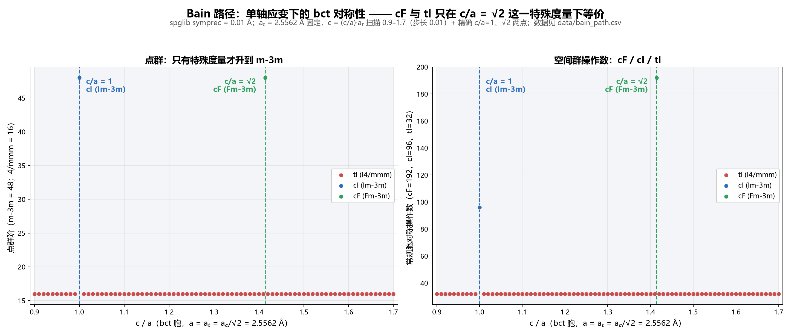
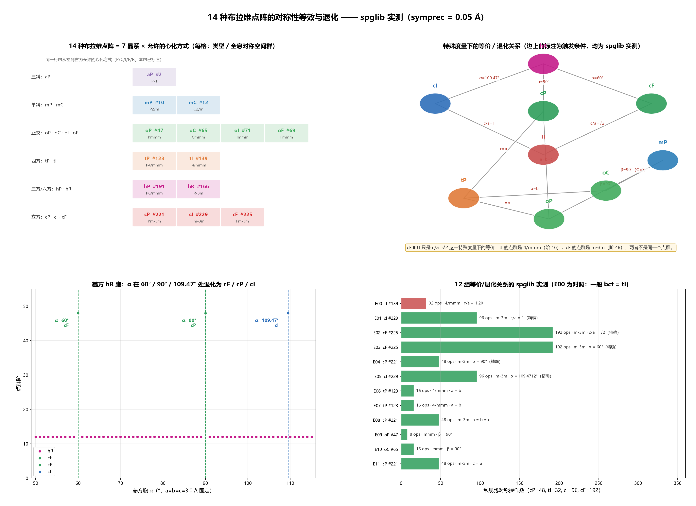

# 用例 2：cF 与 tI 的关系，及 14 种布拉维点阵的对称性等效与退化

> 用户原话：“对比 cF 与 tI 的关系，探究 14 种布拉维点阵的对称性等效与退化。”
>
> 本目录用 **pymatgen 构造晶胞 + spglib 实算**（不抄教科书结论）回答两件事：
> (1) cF（Fm-3m）与 tI（I4/mmm）到底是什么关系；(2) 14 种布拉维点阵在特殊度量下
> 如何互相等价/退化。完整推导与数据见 [report.md](report.md)。

---

## 1. 快速跑

```powershell
$PY = 'D:\Dev\Project5-skill-cif\.venv\Scripts\python.exe'
$env:PYTHONIOENCODING = 'utf-8'

# Bain 路径扫描：data/bain_path.csv + data/bain_tolerance.csv + 2 张 PNG
& $PY usecases\u2_bravais\scripts\bain_path.py

# 14 种布拉维点阵 + 12 组等价/退化关系：
# data/bravais14.csv + data/equivalences.csv + data/hR_alpha_scan.csv + 1 张 PNG
& $PY usecases\u2_bravais\scripts\bravais14.py
```

两个脚本都**不联网**、幂等（重跑覆盖同名产物），退出码 0 表示全部核验通过。
自带 `--help` 不需要；所有可调参数（a_t、c/a 范围、symprec）都在脚本顶部常量里。

---

## 2. 关键结论（全部为实测，数字来源见括号）

| # | 结论 | 实测证据 |
|---|---|---|
| 1 | **cF 与 tI 不是同一个点群**：m-3m（阶 48） vs 4/mmm（阶 16） | `data/equivalences.csv` E00 / E02；空间群 #139 vs #225 |
| 2 | Bain 路径（$a_t=a_c/\sqrt2$ 固定，c/a 从 0.90 扫到 1.70 步长 0.01）：**80 个网格点全是 tI**（I4/mmm，32 个常规胞操作） | `data/bain_path.csv`（82 行 = 80 网格 + 2 精确点） |
| 3 | **c/a = 1**（精确）→ **cI, Im-3m (#229)**，std 胞 a = 2.55619 Å（= a_t），操作数 96 | `bain_path.csv` 中 `c_over_a=1.0` 行 |
| 4 | **c/a = √2**（精确）→ **cF, Fm-3m (#225)**，std 胞 a = 3.615 Å（= a_t√2 = a_c），操作数 192 | `bain_path.csv` 中 `c_over_a=1.414214` 行 |
| 5 | **14 种布拉维点阵全部复核成功**：14/14 与全息对称空间群一致 | `data/bravais14.csv`，`verified=1` 共 14 行 |
| 6 | **12 组**特殊度量等价/退化关系全部通过（12/12） | `data/equivalences.csv` E00–E11 |
| 7 | 菱方 hR：α=60°→**cF**，α=90°→**cP**，α=109.4712°→**cI**；一般 α 为 hR (#166 R-3m) | `data/hR_alpha_scan.csv`（67 行） |
| 8 | 其它退化：oC(a=b)→tP、oP(a=b)→tP、oP(a=b=c)→cP、mP(β=90°)→oP、mC(β=90°)→oC、tP(c=a)→cP | `equivalences.csv` E06–E11 |
| 9 | 特殊度量的“对称性恢复”是**精确度量**才有；symprec 会造出有限窗口（0.05 Å 下 c/a=1.41 被误判为 cF） | `data/bain_tolerance.csv` |

一张图看全部关系：`figures/bravais_relations.png`；
Bain 路径：`figures/bain_symmetry.png`；三种胞的几何：`figures/bain_cells.png`。





---

## 3. 文件清单

| 路径 | 说明 |
|---|---|
| `report.md` | 数学推导 + 全部计算表 + 结论 + 局限（**主文档**） |
| `scripts/common.py` | spglib 判定、Bravais 映射、胞构造、CSV/中文字体工具 |
| `scripts/bain_path.py` | Bain 路径扫描 + `bain_symmetry.png` + `bain_cells.png` |
| `scripts/bravais14.py` | 14 种点阵 + 12 组等价关系 + `bravais_relations.png` |
| `data/bain_path.csv` | 82 行 × 18 列：c/a、胞参数、SG/点群/操作数、Bravais、std 胞、体积/原子、近邻距 |
| `data/bain_tolerance.csv` | 7 行：symprec=0.01 vs 0.05 Å 的判定差异 |
| `data/bravais14.csv` | 14 行 × 23 列：14 种点阵的构造、实测 SG/点群/全息点群、验证标志 |
| `data/hR_alpha_scan.csv` | 67 行：菱方 α 扫描 |
| `data/equivalences.csv` | 12 行 × 21 列：E00–E11 等价/退化实测 |
| `figures/bain_symmetry.png` | 点群阶 / 常规胞操作数 vs c/a（两个特殊点标注） |
| `figures/bain_cells.png` | cF / tI / cI 三胞 3D 示意（含 a_t、c_t 关系） |
| `figures/bravais_relations.png` | 2×2：14 种点阵表、关系图、hR α 扫描、12 组证据条形图 |

---

## 4. 方法要点

* **构造**：Bain 路径用 bct 胞（2 原子基元 `(0,0,0)+(½,½,½)`，`a=b=a_t`，`c=(c/a)a_t`）；
  14 种点阵用“单原子/最小基元 + 不同心化”构造；hR 用 `Lattice.rhombohedral`。
* **判定**：`spglib.get_symmetry_dataset` 求 SG/点群/Wyckoff/标准胞；
  点群阶与常规胞操作数取自 `spglib.get_symmetry_from_database(hall)`，
  因此跨 setting 可比（cP=48、tI=32、cI=96、cF=192）。
* **Bravais 类型**：空间群号→晶系字母 + 国际记号首字母（如 `Fm-3m→cF`、`R-3m→hR`）。
* **容差**：Bain 扫描用 `symprec=0.01 Å`（严格），其余表用 `0.05 Å`；差异单独写在
  `bain_tolerance.csv`，避免“特殊度量处对称性恢复”被容差放大。

---

## 5. 诚实边界

* 未做能量计算：不讨论 fcc/bcc 相对稳定性、Bain 能垒；`volume_per_atom` 列也表明
  Bain 路径**不是等体积**路径。
* 只用一个元素（Cu）构造虚设点阵，避免化学占位降低对称性；不涉及合金/磁序/电荷有序。
* hR α 扫描止于 115°（更极端 α 下 spglib 在给定容差下无法判定，脚本记录并跳过）。
* hP 在所有尝试的 c/a 下都没有退化到其它 Bravais 型（负结果，仅在 report.md 说明）。
* “14 个全息对称空间群”的命名来自国际表；本目录实测的是每个点阵经 spglib
  还原出的最大空间群与表中编号一致（14/14），未做独立的群论证明。
* 所有数字都能在 `data/*.csv` 中找到；报告与图不引入 CSV 之外的“经验值”
  （晶胞构造参数是人为设定的输入，已列在 `bravais14.csv` 的 `construction` 列）。
